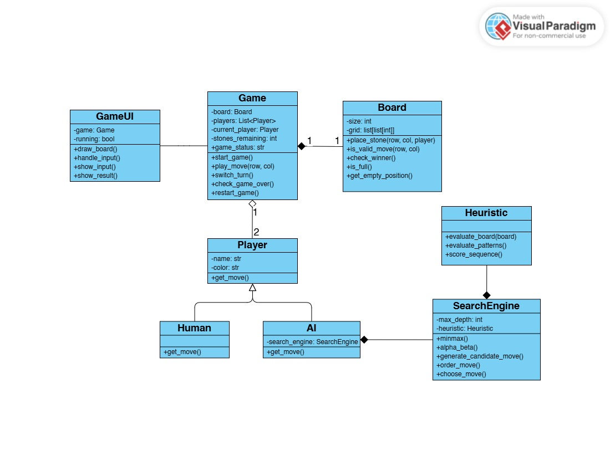

# Connect6 Game — Class Design & Workflow

> **Purpose:** This document explains every class in the class diagram
> (`Connect6_Class_Diagram.jpg`): what each attribute and method is for,
> how the classes relate to one another, and how a complete game flows
> from start to finish.
>
> **Scope:** The diagram contains **eight classes**: `GameUI`, `Game`,
> `Board`, `Player`, `Human`, `AI`, `SearchEngine`, and `Heuristic`.
> `GameUI` is the presentation layer. The other seven hold the game
> logic and the AI. All names, attributes, and method signatures below
> follow the diagram exactly.

---

## 1. Connect6 rules the design must support

Connect6 is a two-player connection game played on a grid.

- Players use different stone colours.
- The first player places **one stone** on the first turn.
- After that, each player places **two stones per turn**.
- A player wins by making **six consecutive stones** in a line:
  horizontal, vertical, or diagonal.
- If the first stone of a two-stone turn wins, the game ends
  immediately and the second stone is not placed.
- Stones must be placed on valid, empty cells.

These rules are why `Game` has a `stones_remaining` attribute: the
current player must not change after every single stone, only after the
required number of stones has been placed.

---

## 2. The class diagram at a glance



### 2.1 Class overview

| Class          | Role                     | One-line responsibility                                            |
| -------------- | ------------------------ | ------------------------------------------------------------------ |
| `GameUI`       | Presentation             | Draws the game, captures user input, shows results.                |
| `Game`         | Controller               | Runs the game, enforces turn rules, tracks state, detects the end. |
| `Board`        | Data / rules of the grid | Stores the grid and performs board-level checks.                   |
| `Player`       | Base class               | Common interface (`name`, `color`, `get_move()`) for all players.  |
| `Human`        | Player subclass          | A person whose move comes from the UI.                             |
| `AI`           | Player subclass          | A computer player whose move comes from the search engine.         |
| `SearchEngine` | AI brain                 | Searches future positions and picks the best move.                 |
| `Heuristic`    | AI evaluator             | Scores a board position so positions can be compared.              |

### 2.2 Relationships

| Relationship                 | Diagram notation       | Meaning                                                                                                                                   |
| ---------------------------- | ---------------------- | ----------------------------------------------------------------------------------------------------------------------------------------- |
| `GameUI` — `Game`            | Plain association line | The UI holds a reference to the `Game` (`game: Game`). It reads the state to draw it and sends user actions to it.                        |
| `Game` ◆ `Board` (1 : 1)     | Filled diamond         | **Composition.** Each game owns exactly one board. The board has no meaning outside its game and is created and destroyed with it.        |
| `Game` ◇ `Player` (1 : 2)    | Hollow diamond         | **Aggregation.** A game has exactly two players. Players are separate objects that are _given to_ the game and could exist independently. |
| `Human` ▷ `Player`           | Hollow triangle        | **Inheritance.** `Human` is a kind of `Player`.                                                                                           |
| `AI` ▷ `Player`              | Hollow triangle        | **Inheritance.** `AI` is a kind of `Player`.                                                                                              |
| `AI` ◆ `SearchEngine`        | Filled diamond         | **Composition.** Each AI owns the search engine it uses to decide moves.                                                                  |
| `SearchEngine` ◆ `Heuristic` | Filled diamond         | **Composition.** Each search engine owns the heuristic it uses to score positions.                                                        |

### 2.3 Ownership chain

```text
GameUI ──── Game ◆──── Board
             ◇
             │ 2
          Player
          ▲     ▲
       Human     AI ◆──── SearchEngine ◆──── Heuristic
```

---

## 3. Classes, attributes, and methods

### 3.1 `GameUI`

**Responsibility:** Everything the user sees and touches. It contains no
game rules. It only displays the state of `Game` and passes user actions
to it. Keeping it separate means the same game logic could be used with
a different interface (for example console instead of graphical).

#### Attributes

| Attribute | Type   | Meaning and use                                                                        |
| --------- | ------ | -------------------------------------------------------------------------------------- |
| `game`    | `Game` | The game this interface displays and controls. This is the association with `Game`.    |
| `running` | `bool` | Whether the UI loop is active. Set to `False` to close the window or exit the program. |

#### Methods

| Method           | What it does                                                                                                                                                               |
| ---------------- | -------------------------------------------------------------------------------------------------------------------------------------------------------------------------- |
| `draw_board()`   | Draws the grid and all placed stones using the data in `game.board`. Called after every successful move and after a restart.                                               |
| `handle_input()` | Listens for user actions (clicking a cell, pressing restart, closing the window) and converts them into calls such as `game.play_move(row, col)` or `game.restart_game()`. |
| `show_input()`   | Gives the user feedback about their input, for example a highlighted cell, a "your turn" prompt, or an "invalid move" message.                                             |
| `show_result()`  | Displays the end of the game: who won, or that the game was a draw, based on `game.game_status`.                                                                           |

---

### 3.2 `Game`

**Responsibility:** The central controller. It coordinates the board and
the players, enforces the Connect6 turn rules, and decides when the game
is over.

#### Attributes

| Attribute          | Type           | Meaning and use                                                                                                                     |
| ------------------ | -------------- | ----------------------------------------------------------------------------------------------------------------------------------- |
| `board`            | `Board`        | The board the game is played on (composition, 1 : 1).                                                                               |
| `players`          | `List<Player>` | The two participants (aggregation, 1 : 2). Each may be a `Human` or an `AI`.                                                        |
| `current_player`   | `Player`       | Whose turn it is right now.                                                                                                         |
| `stones_remaining` | `int`          | How many stones the current player still has to place in this turn: **1** on the opening turn, otherwise **2**, counting down to 0. |
| `game_status`      | `str`          | The state of the game, such as `"playing"`, `"won"`, or `"draw"`. Public (`+`) so `GameUI` can read it.                             |

#### Methods

| Method                | What it does                                                                                                                                                                                                                                                           |
| --------------------- | ---------------------------------------------------------------------------------------------------------------------------------------------------------------------------------------------------------------------------------------------------------------------- |
| `start_game()`        | Prepares a new game: sets up the board, picks the first player, sets `stones_remaining = 1` for the opening turn, and sets `game_status` to playing.                                                                                                                   |
| `play_move(row, col)` | Handles **one stone placement**. It checks the game is active, validates the cell with `board.is_valid_move()`, places the stone with `board.place_stone()`, checks for game over, decrements `stones_remaining`, and calls `switch_turn()` when the turn is finished. |
| `switch_turn()`       | Makes the other player the `current_player` and sets `stones_remaining = 2` for the new turn.                                                                                                                                                                          |
| `check_game_over()`   | Asks the board whether the last stone created six in a row (`check_winner()`) or whether the board is full (`is_full()`), and updates `game_status` accordingly.                                                                                                       |
| `restart_game()`      | Clears the board and resets all state so a new match can begin.                                                                                                                                                                                                        |

> **Implementation note:** `play_move()` handles one stone, not a whole
> turn. After the first stone of a normal turn the same player stays
> active. If that first stone wins, the game ends right away and the
> second stone is never placed.

---

### 3.3 `Board`

**Responsibility:** Stores the grid and offers the operations to read
and change it. It knows nothing about turns or players' identities
beyond what is written in the cells. Whose turn it is belongs to `Game`.

#### Attributes

| Attribute | Type              | Meaning and use                                                                                            |
| --------- | ----------------- | ---------------------------------------------------------------------------------------------------------- |
| `size`    | `int`             | Board dimension (the number of rows and columns of a square board).                                        |
| `grid`    | `list[list[int]]` | The cells. Each cell stores `0` if empty, otherwise an identifier for the player who owns the stone there. |

#### Methods

| Method                          | What it does                                                                                                                                                                                                                                                        |
| ------------------------------- | ------------------------------------------------------------------------------------------------------------------------------------------------------------------------------------------------------------------------------------------------------------------- |
| `place_stone(row, col, player)` | Puts the player's stone into the cell. It should only change an in-range, empty cell.                                                                                                                                                                               |
| `is_valid_move(row, col)`       | Returns `True` if the coordinates are inside the board **and** the cell is empty.                                                                                                                                                                                   |
| `check_winner()`                | Checks whether the most recently placed stone completes **six consecutive stones** in any of the four directions (horizontal, vertical, two diagonals). It is efficient to check only the lines through the last stone, so the board should remember the last move. |
| `is_full()`                     | Returns `True` if there are no empty cells left. If nobody has won, this means a draw.                                                                                                                                                                              |
| `get_empty_position()`          | Returns the empty cells. Used mainly by the AI to generate possible moves.                                                                                                                                                                                          |

---

### 3.4 `Player` (base class)

**Responsibility:** Defines what every kind of player has in common.
`Game` can then ask any player for a move without caring whether it is a
human or the AI. This is **polymorphism**.

#### Attributes

| Attribute | Type  | Meaning and use                                                                     |
| --------- | ----- | ----------------------------------------------------------------------------------- |
| `name`    | `str` | The player's display name.                                                          |
| `color`   | `str` | The stone colour (for example black or white) that identifies this player's stones. |

#### Methods

| Method       | What it does                                                                                 |
| ------------ | -------------------------------------------------------------------------------------------- |
| `get_move()` | Returns the `(row, col)` this player wants to play. Each subclass implements it differently. |

---

### 3.5 `Human`

**Responsibility:** Represents a person. Its move comes from what the
user selects in the interface.

#### Attributes

None of its own. It inherits `name` and `color` from `Player`.

#### Methods

| Method       | What it does                                                                                                               |
| ------------ | -------------------------------------------------------------------------------------------------------------------------- |
| `get_move()` | Overrides `Player.get_move()`. Returns the row and column the user chose through `GameUI` (for example, the clicked cell). |

> **Design note:** `Human` does not draw anything. `GameUI` collects the
> click; `Human` only represents the participant who made it.

---

### 3.6 `AI`

**Responsibility:** Represents the computer player. It does not decide
moves itself; it asks its `SearchEngine`.

#### Attributes

| Attribute       | Type           | Meaning and use                                                        |
| --------------- | -------------- | ---------------------------------------------------------------------- |
| `search_engine` | `SearchEngine` | The engine used to analyse the position and pick a move (composition). |

It also inherits `name` and `color` from `Player`.

#### Methods

| Method       | What it does                                                                                                                      |
| ------------ | --------------------------------------------------------------------------------------------------------------------------------- |
| `get_move()` | Overrides `Player.get_move()`. Calls `search_engine.choose_move()` with the current position and returns the chosen `(row, col)`. |

> **Design note:** Keep AI decision-making out of `Game`. `Game` simply
> asks the current player for a move; `AI` and `SearchEngine` handle how
> that move is chosen.

---

### 3.7 `SearchEngine`

**Responsibility:** Looks ahead through possible future positions and
chooses the move that gives the AI the best outcome.

#### Attributes

| Attribute   | Type        | Meaning and use                                                                 |
| ----------- | ----------- | ------------------------------------------------------------------------------- |
| `max_depth` | `int`       | How many levels of moves the search looks ahead. Higher is stronger but slower. |
| `heuristic` | `Heuristic` | The evaluator used to score positions (composition).                            |

#### Methods

| Method                      | What it does                                                                                                                                                       |
| --------------------------- | ------------------------------------------------------------------------------------------------------------------------------------------------------------------ |
| `choose_move()`             | **Main entry point** (called by `AI.get_move()`). Generates candidates, orders them, runs the search, and returns the best move.                                   |
| `generate_candidate_move()` | Produces the promising empty cells to consider, typically those near existing stones. Searching every empty cell is far too expensive, so this narrows the search. |
| `order_move()`              | Sorts the candidates so the most promising are explored first. Good ordering makes alpha-beta pruning cut far more branches.                                       |
| `minimax()`                 | Recursively explores moves. The AI picks the move that **maximizes** the score; the opponent is assumed to pick the move that **minimizes** it.                    |
| `alpha_beta()`              | Minimax with **alpha-beta pruning**: it skips branches that cannot change the final decision, giving the same answer with much less work.                          |

#### How the search works

1.  `generate_candidate_move()` produces a short list of candidate cells.
2.  `order_move()` sorts them from most to least promising.
3.  Each candidate is simulated on a **copy** of the position.
4.  `alpha_beta()` / `minimax()` explore the opponent's replies and
    continue until `max_depth` is reached or someone wins.
5.  At the depth limit, `Heuristic.evaluate_board()` scores the position.
6.  Scores are passed back up the search tree.
7.  `choose_move()` returns the candidate with the best score.

> **Important:** The search must follow real Connect6 turn structure. A
> simulated turn contains **two** placements by the **same** player, and
> the opening turn contains one. The search state therefore needs to
> track the board, the player to move, and the stones remaining in the
> turn. Simulations must never modify the real `Game.board`.

---

### 3.8 `Heuristic`

**Responsibility:** Gives a numeric score to a board position so the
search engine can compare positions that are not yet won or lost. It
**scores** positions; it never chooses moves.

#### Attributes

None in the initial design. Scoring weights can be added later as
constants or configuration.

#### Methods

| Method                  | What it does                                                                                                                                                         |
| ----------------------- | -------------------------------------------------------------------------------------------------------------------------------------------------------------------- |
| `evaluate_board(board)` | Returns the overall score of the board from the AI's point of view. Positive favours the AI, negative favours the opponent. This is the method `SearchEngine` calls. |
| `evaluate_patterns()`   | Scans the board for meaningful stone patterns for both sides (runs of stones, open or blocked ends) and combines them into a total.                                  |
| `score_sequence()`      | Scores one individual sequence based on its length, whether its ends are open or blocked, and how close it is to six.                                                |

#### Example of heuristic thinking

- Four AI stones in a row with both ends open should score much
  higher than two isolated AI stones.
- An opponent's sequence that is one or two stones from six should
  produce a strongly negative score, which makes the AI prioritize
  blocking.

---

## 4. Complete game workflow

### 4.1 Starting a game

1.  `GameUI` is created with a reference to a `Game` and sets
    `running = True`.
2.  `Game.start_game()` sets up the `Board`, chooses the first player,
    sets `stones_remaining = 1` and `game_status` to playing.
3.  `GameUI.draw_board()` shows the empty board.

### 4.2 Human move

1.  The user clicks a cell; `GameUI.handle_input()` detects it.
2.  `Game` asks the current `Human` player for its move
    (`Human.get_move()`), which returns the clicked `(row, col)`.
3.  `Game.play_move(row, col)` calls `Board.is_valid_move(row, col)`.
4.  If invalid, the move is rejected, nothing changes, and
    `GameUI.show_input()` tells the user.
5.  If valid, `Board.place_stone(row, col, player)` updates the grid.
6.  `Game.check_game_over()` calls `Board.check_winner()` and
    `Board.is_full()`.
7.  If the game is over, `game_status` is updated and
    `GameUI.show_result()` displays the outcome.
8.  Otherwise `stones_remaining` is decreased.
9.  If stones remain, the **same** player moves again.
10. If none remain, `Game.switch_turn()` changes `current_player` and
    sets `stones_remaining = 2`.
11. `GameUI.draw_board()` redraws the updated board.

### 4.3 AI move

1.  `Game` sees that `current_player` is an `AI`.
2.  `Game` calls `AI.get_move()`.
3.  `AI.get_move()` calls `SearchEngine.choose_move()`.
4.  `SearchEngine` calls `generate_candidate_move()` and
    `order_move()`.
5.  `minimax()` / `alpha_beta()` search future positions on copies of
    the board.
6.  At the depth limit, the engine calls `Heuristic.evaluate_board()`.
    That method uses `evaluate_patterns()`, which uses
    `score_sequence()`.
7.  Scores flow back up the tree and the best `(row, col)` is returned.
8.  The result goes through the **same** `Game.play_move(row, col)` used
    for humans, so validation and win checks are identical.
9.  `Game` updates `stones_remaining` and switches turns if needed.
10. `GameUI.draw_board()` redraws the board.

### 4.4 End of game and restart

1.  When `check_game_over()` finds six in a row, `game_status` records
    the winner. If the board is full with no winner, it records a draw.
2.  `GameUI.show_result()` displays the outcome.
3.  If the user chooses to play again, `GameUI.handle_input()` calls
    `Game.restart_game()`, which resets the state, and the cycle starts
    again at 4.1.

### 4.5 Sequence overview

```text
User        GameUI          Game            Board        Player / AI     SearchEngine   Heuristic
 │  click     │               │               │              │               │             │
 ├───────────►│ handle_input  │               │              │               │             │
 │            ├──────────────►│ play_move     │              │               │             │
 │            │               ├──────────────►│ is_valid_move│               │             │
 │            │               ├──────────────►│ place_stone  │               │             │
 │            │               ├──────────────►│ check_winner │               │             │
 │            │◄──────────────┤ (state updated)              │               │             │
 │            │ draw_board    │               │              │               │             │
 │            │               │  AI's turn?   │              │               │             │
 │            │               ├─────────────────────────────►│ get_move      │             │
 │            │               │               │              ├──────────────►│ choose_move │
 │            │               │               │              │               ├────────────►│ evaluate_board
 │            │               │◄─────────────────────────────┤ (row, col)    │             │
 │            │               ├──► play_move(row, col) (same path as a human)│             │
```

---

## 5. Critical implementation decisions

1.  **One stone is one move; two stones make a normal turn.** Do not
    switch players after the first stone of a two-stone turn.
2.  **The opening turn is special.** The first player places exactly one
    stone.
3.  **Check for a win after every stone.** A player can win with the
    first stone of a turn.
4.  **Use one move path.** Human and AI moves both go through
    `Game.play_move()`.
5.  **Keep responsibilities separate.** `GameUI` displays, `Game`
    controls the rules, `Board` manages cells, `SearchEngine` searches,
    and `Heuristic` evaluates.
6.  **Do not let the search change the real board.** Use copies or
    reversible simulated moves.
7.  **Represent the search state completely.** It needs the board, the
    player to move, and the stones remaining in the turn; otherwise the
    AI may analyse illegal turn sequences.
8.  **Keep the UI free of game rules.** `GameUI` calls `Game`, never the
    reverse for rule decisions, so the interface can be swapped.
9.  **Decide how `Board.check_winner()` knows the last move.** The
    diagram shows no parameter, so store `last_move` inside `Board`
    (set in `place_stone()`), or add a parameter.

---

**The key idea:** `GameUI` shows and listens, `Game` manages the rules,
`Board` manages the grid, `Human` and `AI` supply moves, `SearchEngine`
decides the AI's move, and `Heuristic` scores positions. Keeping these
responsibilities separate makes the project easier to implement, debug,
and extend.
